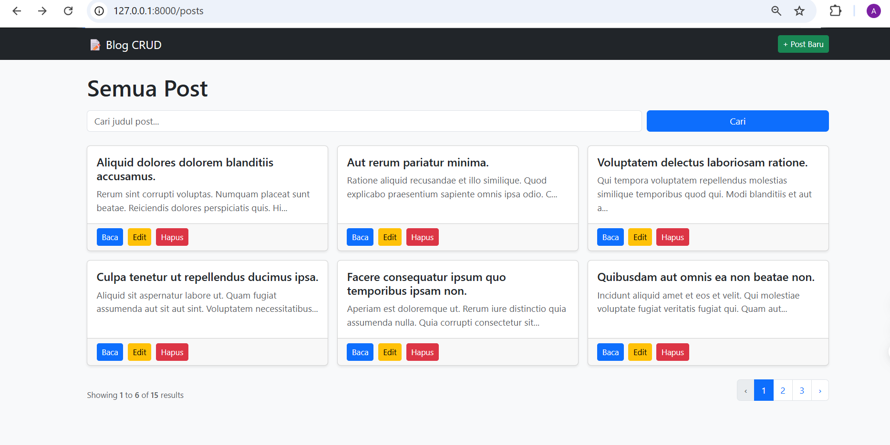
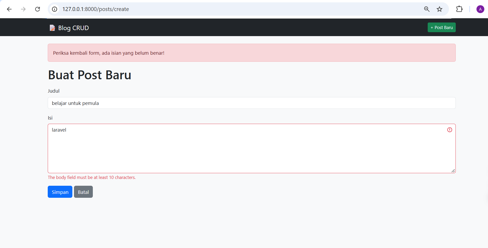
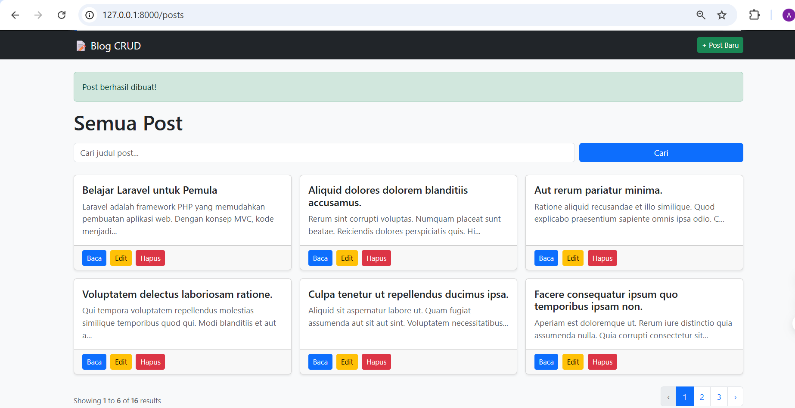
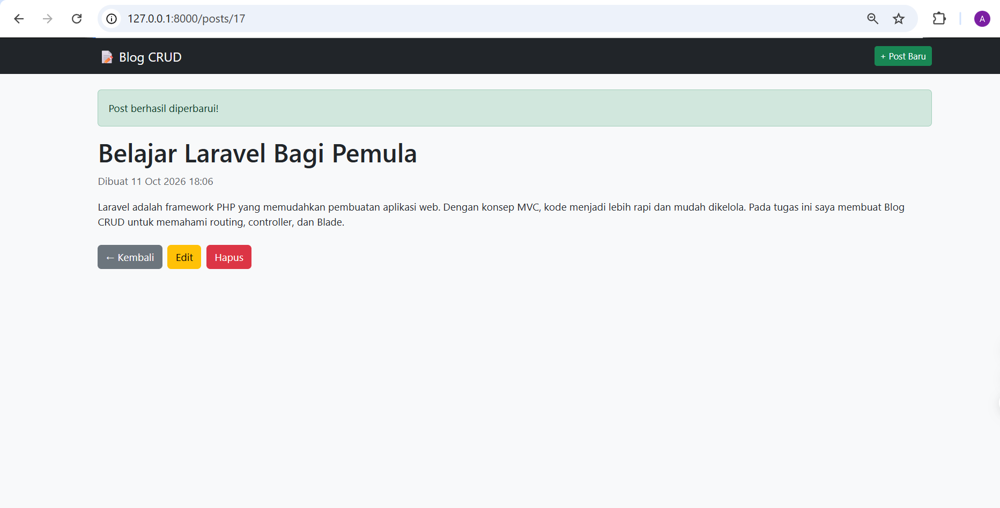
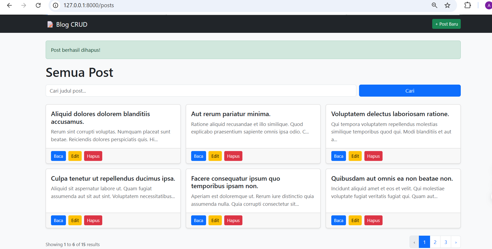
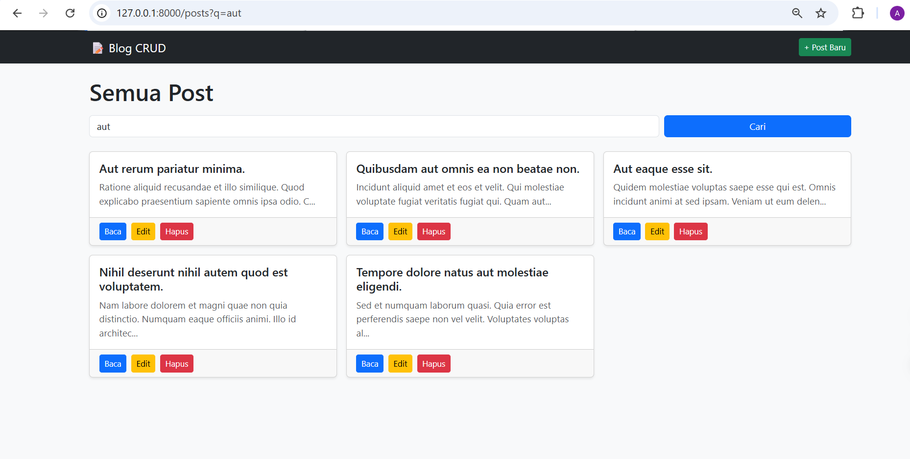
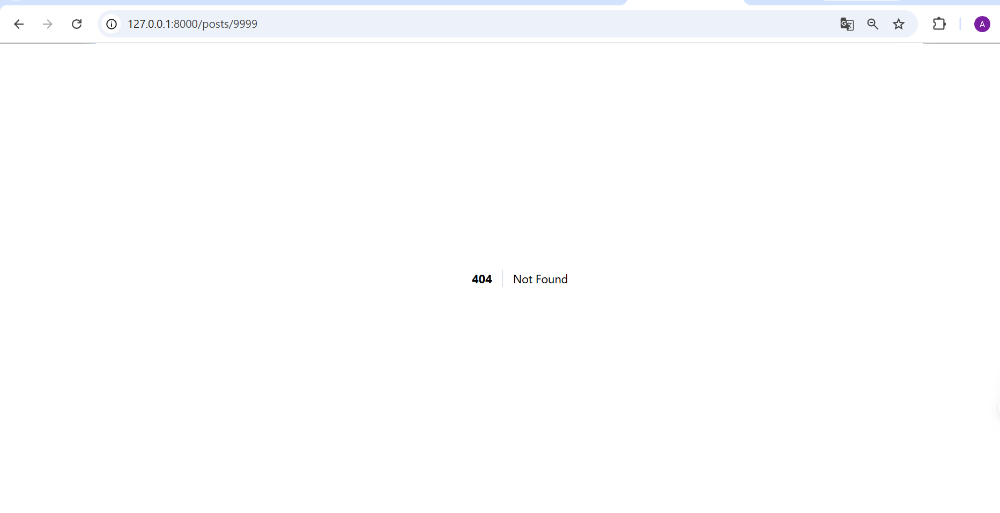

# Blog CRUD Laravel

Tugas Rutin 10 Pemrograman Web (Pertemuan 10): aplikasi blog sederhana dengan operasi CRUD memakai Laravel dan MySQL.

## Fitur

- Route resource `posts` dengan named routes
- PostController resource (7 method)
- Blade layout master (`@extends` dan `@yield`)
- Dua Blade component: `alert` dan `card`
- Validasi, error per field, dan old input
- Flash message sukses dan gagal
- `@csrf` di semua form, `@method('PUT')` dan `@method('DELETE')`
- Route Model Binding dan pagination
- Bonus: pencarian judul

## Cara Menjalankan

1. Clone repo dan masuk ke foldernya
2. Install dependensi: `composer install`
3. Salin `.env.example` menjadi `.env`, lalu atur database (`DB_DATABASE=blog_crud`)
4. Buat database `blog_crud` di MySQL
5. Jalankan: `php artisan key:generate`
6. Jalankan: `php artisan migrate`
7. (Opsional) isi data contoh lewat `php artisan tinker`, lalu `App\Models\Post::factory()->count(15)->create();`
8. Jalankan server: `php artisan serve`, lalu buka `http://127.0.0.1:8000`

## Screenshot

### Daftar Post dan Pagination

### Validasi, Error per Field, dan Old Input

### Buat Post Baru (Flash Message Sukses)

### Detail dan Edit Post

### Hapus Post

### Pencarian

### Route Model Binding (404)
